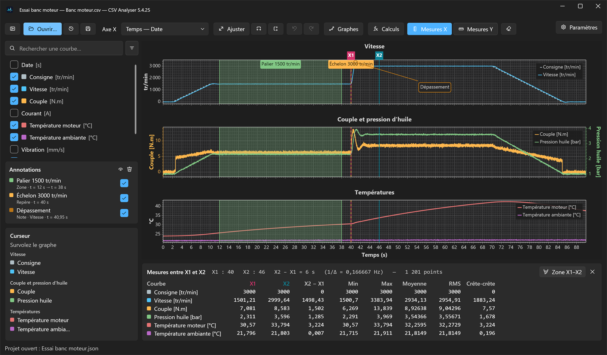
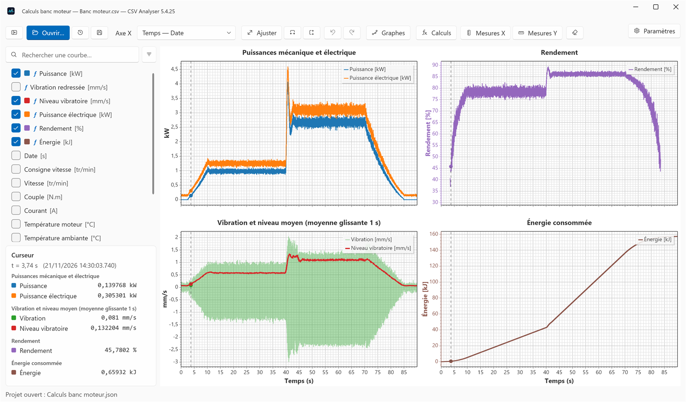
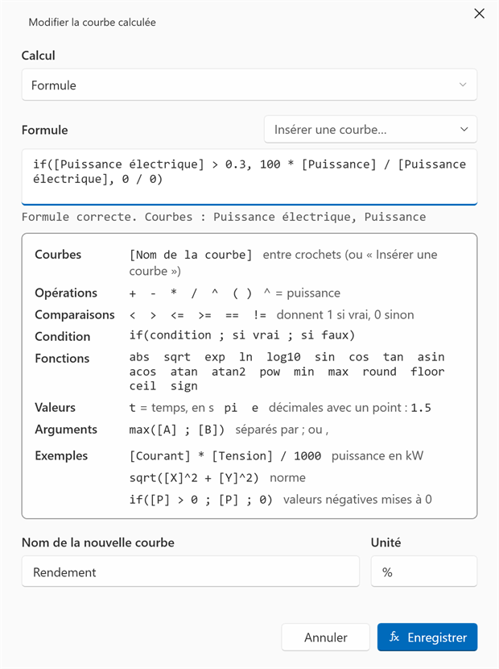
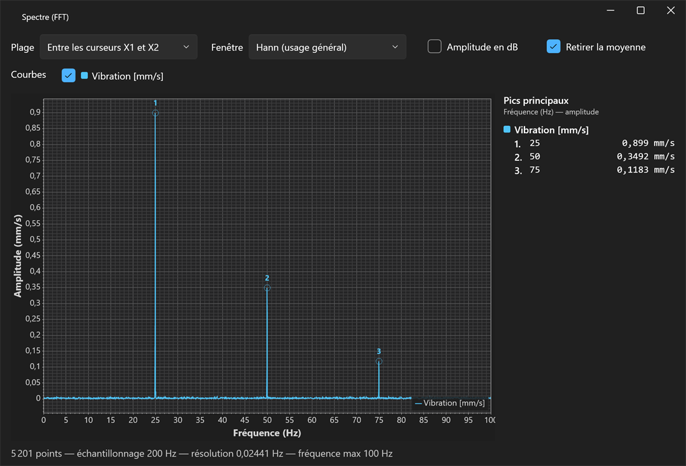

# CSV Analyser

**Un outil Windows pour explorer, mesurer et mettre en forme des fichiers de mesures CSV, même très gros, sans écrire une ligne de code.**



## Pourquoi cette application

Depuis des années, j'exploite des fichiers CSV issus de bancs d'essais et d'enregistreurs : des dizaines de colonnes, des centaines de milliers de lignes. Pour les regarder, j'utilisais une petite application maison. Elle faisait le travail pour un premier coup d'œil, mais elle restait vite limitée : impossible de superposer proprement des grandeurs d'unités différentes, de comparer deux zones, de calculer une courbe à partir des autres…

Dès que l'analyse devenait un peu plus poussée, je passais sur Python. C'est puissant, mais pour obtenir un graphique lisible et présentable il faut à chaque fois réécrire du code, régler les axes, les couleurs, les légendes. Beaucoup de temps passé sur la mise en page plutôt que sur les données.

Aujourd'hui, grâce au *vibe coding* (le développement assisté par l'IA, ici avec Claude), j'ai pu construire l'application dont je rêvais : on ouvre le fichier, on coche les courbes, on range, on mesure, on calcule, et le résultat est prêt à être copié dans un rapport.

Je suis assez content de cette première version. J'espère qu'elle pourra aider d'autres personnes qui passent, elles aussi, leurs journées dans des fichiers de mesures.

## Ce qu'elle sait faire

### Ouvrir des fichiers lourds, quel que soit leur format
- Des fichiers de **plusieurs centaines de Mo** (environ 1 s pour 400 Mo) avec une centaine de colonnes.
- Détection automatique du séparateur (`;` `,` tabulation `|`), de la virgule ou du point décimal, de l'encodage, d'un éventuel en-tête de fichier, d'une ligne d'unités ou d'unités entre crochets (`Vitesse [tr/min]`).
- Les colonnes de date ou d'horodatage deviennent un axe de temps en secondes, la date absolue reste affichée sous le curseur.
- Glisser-déposer d'un fichier sur la fenêtre, liste des fichiers récents.

### Mettre en page sans effort
- **Graphes empilés** ou en **colonnes** (jusqu'à 4), qui partagent le même axe X ; on déplace une courbe d'un graphe à l'autre par glisser-déposer.
- **Plusieurs axes Y** par graphe : une unité par axe, automatiquement, à gauche ou à droite, avec alignement des zéros si besoin.
- Pour chaque courbe : nom, unité, couleur, épaisseur, pointillés, marqueurs (un par point ou espacés), opacité, ordre d'affichage.
- Titres de graphes, légendes déplaçables, quadrillage réglable, cinq thèmes (clair, sombre, oscilloscope, bleu nuit, impression).
- Copie ou enregistrement de l'image d'un graphe ou de tous les graphes, en PNG ou JPEG, à la résolution voulue.

### Mesurer comme sur un oscilloscope
- **Curseur** qui suit la souris et affiche la valeur de chaque courbe, groupée par graphe.
- **Deux curseurs X1 / X2** : valeurs aux deux points, écart, min, max, moyenne, RMS, crête-crête de chaque courbe entre les deux.
- **Deux curseurs Y1 / Y2** sur un axe pour lire un écart en hauteur.
- **Annotations** : repères, zones surlignées, notes attachées à un point d'une courbe. Elles restent sur les mêmes échantillons quel que soit l'axe X choisi.

### Calculer de nouvelles courbes





- **Formules** entre courbes : `[Couple] * [Vitesse] * 2 * pi / 60`, fonctions mathématiques, comparaisons, conditions `if(…)`.
- **Filtres** : moyenne glissante, passe-bas et passe-haut (avec option sans déphasage), dérivée, intégrale.
- Une courbe calculée se comporte comme une colonne du fichier : elle peut être tracée, mesurée, exportée, servir dans une autre formule, ou même devenir l'axe X (par exemple `t / 60` pour un temps en minutes).

<br clear="right">

### Analyser en fréquence



- **Spectre (FFT)** des courbes choisies, sur la vue, entre les curseurs ou sur tout l'enregistrement.
- Fenêtres de Hann, flat-top ou rectangulaire, amplitude linéaire ou en dB.
- Les **5 pics principaux** de chaque courbe sont numérotés et listés ; un clic zoome dessus.

### Retrouver son travail
- **Annuler / rétablir** (Ctrl+Z / Ctrl+Y) sur tout : zoom, styles, courbes, graphes, annotations.
- La mise en page de chaque fichier est retrouvée automatiquement à sa réouverture.
- **Projets** (`.json`) : le fichier CSV et toute sa mise en page, à rouvrir d'un double-clic.
- **Configurations réutilisables** : la même mise en page appliquée à un autre enregistrement qui a les mêmes colonnes.
- **Export CSV** de tout ou partie des données (zone visible, entre les curseurs), courbes calculées comprises.

### Et aussi
- Interface en français ou en anglais.
- Taille de l'interface et du texte des graphes réglables (pratique sur grand écran ou en présentation).
- Zoom à la molette, au rectangle, par axe ; clic sur une borne d'axe pour la saisir au clavier.

## Installation

1. Télécharger `CSV-Analyser.exe` dans la page [Releases](https://github.com/rodolpheGiammatteo/CSV_analyser/releases).
2. Le lancer. C'est tout : aucun installateur, rien d'autre à installer (le fichier contient tout ce dont il a besoin, d'où sa taille d'environ 75 Mo).

Windows 10 ou 11, 64 bits. Au premier lancement, Windows SmartScreen peut afficher « Éditeur inconnu » : *Informations complémentaires* puis *Exécuter quand même*.

## Essayer avec l'exemple

Le dossier [`exemples`](exemples) contient un enregistrement fictif d'un banc d'essai moteur (`Banc moteur.csv` : vitesse, couple, courant, températures, vibration…) et trois projets prêts à ouvrir :

| Projet | Ce qu'il montre |
|---|---|
| `Essai banc moteur.json` | Graphes empilés, deux axes Y, annotations, mesures entre curseurs |
| `Calculs banc moteur.json` | Courbes calculées en deux colonnes : puissances, rendement, énergie, niveau vibratoire |
| `Vibration banc moteur.json` | Zoom avec marqueurs ; ouvrir *Calculs → Spectre (FFT)* pour voir les harmoniques |

Ouvrir le projet avec le bouton *Ouvrir…* ou en le glissant sur la fenêtre ; le CSV est retrouvé à côté de lui.

## Compiler depuis les sources

Il faut le [SDK .NET 10](https://dotnet.microsoft.com/download).

```powershell
dotnet build CsvAnalyser.sln
dotnet test CsvAnalyser.sln
dotnet run --project src/CsvAnalyser.App -- "chemin\fichier.csv"
```

Pour produire l'exe autonome :

```powershell
dotnet publish src/CsvAnalyser.App -c Release -r win-x64 --self-contained -p:PublishSingleFile=true -p:IncludeNativeLibrariesForSelfExtract=true -p:EnableCompressionInSingleFile=true -p:DebugType=none -o publish
```

Construit avec WPF (.NET 10), [ScottPlot 5](https://scottplot.net), [WPF-UI](https://github.com/lepoco/wpfui) et [CommunityToolkit.Mvvm](https://github.com/CommunityToolkit/dotnet).

## Licence

CSV Analyser est un logiciel libre, distribué sous la licence [GNU GPL v3](LICENSE).

Vous pouvez l'utiliser librement, y compris dans un cadre professionnel, l'étudier, le modifier et le redistribuer. Toute version redistribuée, modifiée ou non, doit rester sous la même licence et être accompagnée de son code source.

Les bibliothèques utilisées restent sous leur propre licence (MIT pour ScottPlot, WPF-UI, CommunityToolkit et .NET).
